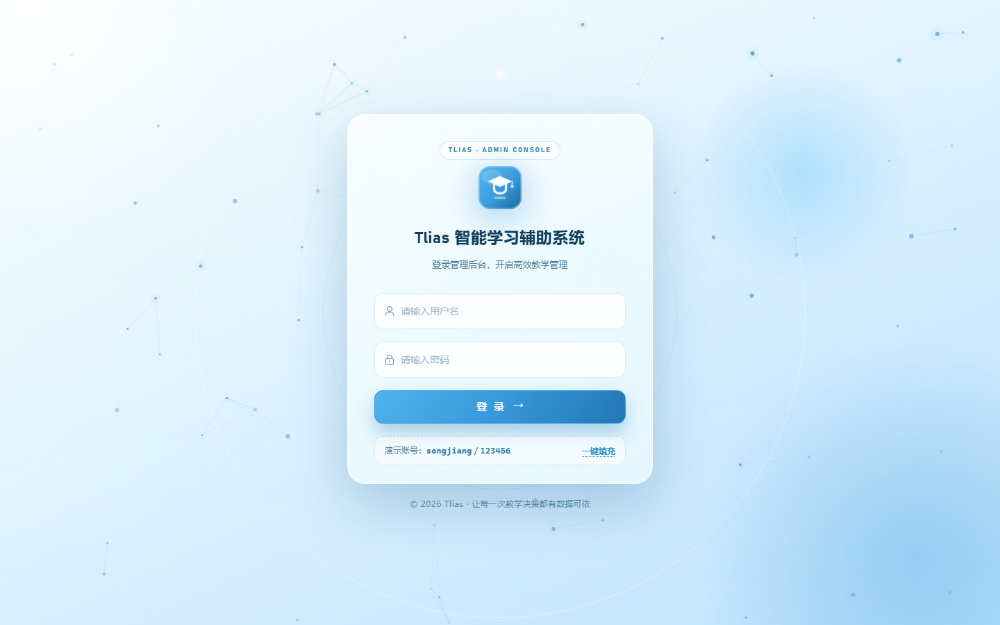
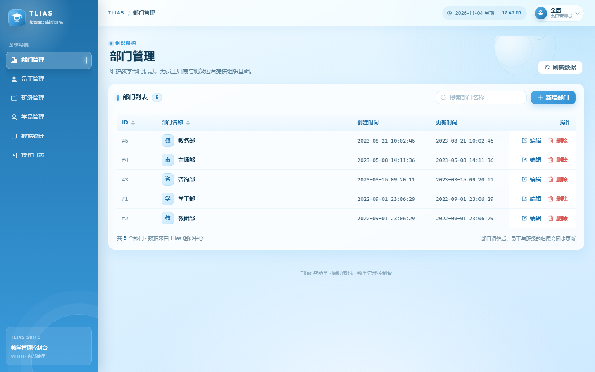
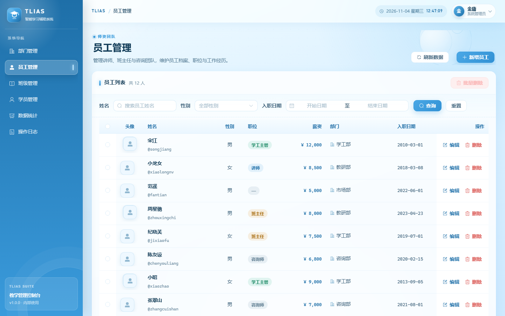
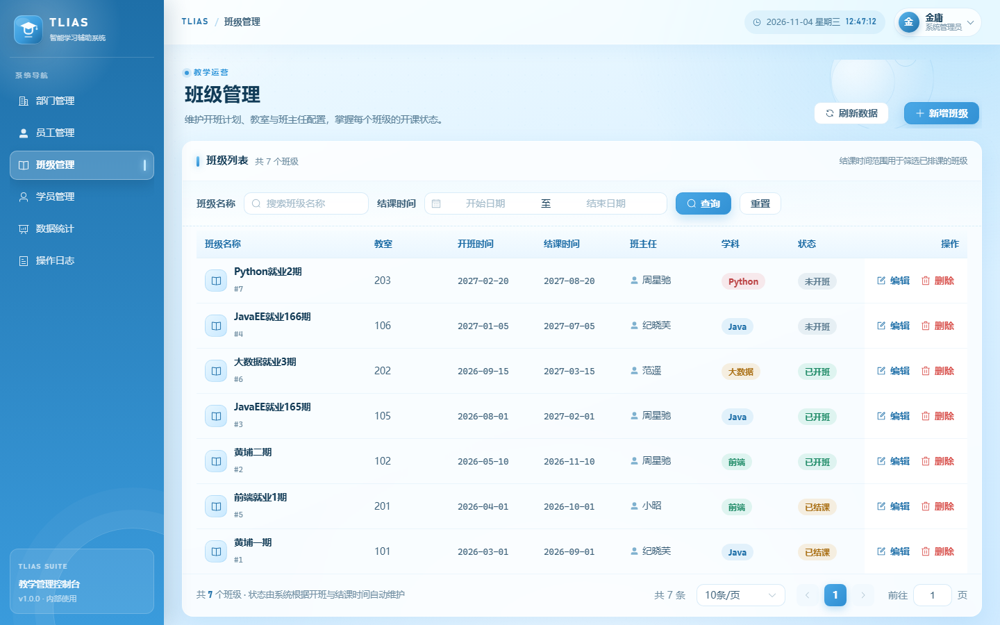
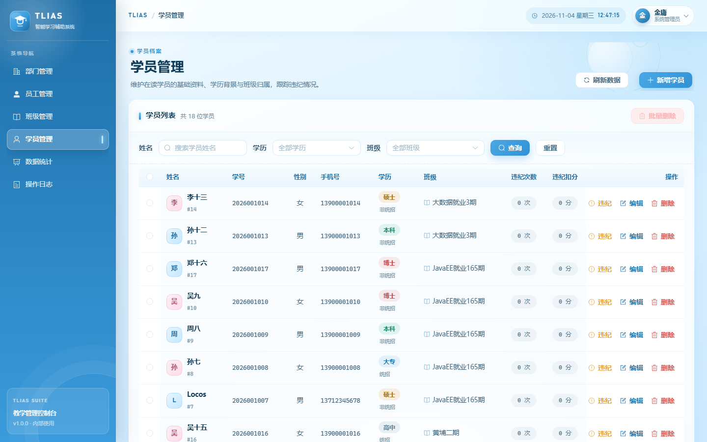
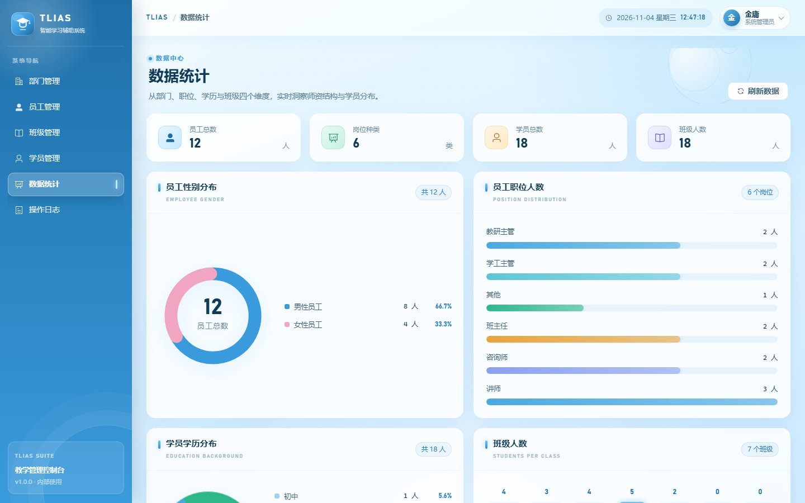
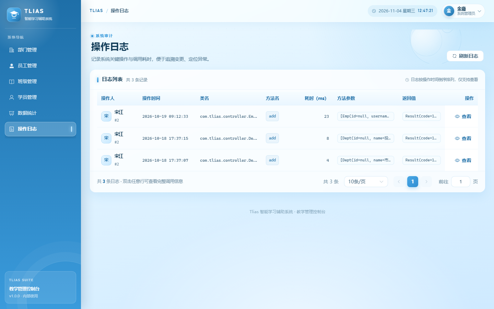

# Tlias 智能学习辅助系统

严格按照 `api接口文档.md`（Tlias 接口文档）实现的完整前后端分离项目：

- **后端**：Java 17 + Spring Boot 3.2 + MyBatis + PageHelper + MySQL 8 + JWT + 阿里云 OSS
- **前端**：Vue 3 + Vite 5 + Element Plus + Axios + Vue Router（天蓝色主题、登录页粒子特效）
- **数据库**：MySQL 8，库名 `testdemo`

---

## 一、项目结构

```
tlias
├─ docs/screenshots                    # 界面截图（登录、部门、员工、班级、学员、统计、日志）
├─ sql
│  └─ testdemo.sql                     # 数据库初始化脚本（建库建表 + 演示数据）
├─ tlias-backend                       # Java 后端（Maven）
│  ├─ pom.xml
│  └─ src/main
│     ├─ java/com/tlias
│     │  ├─ TliasApplication.java      # 启动类
│     │  ├─ annotation/Log.java        # 操作日志注解
│     │  ├─ aop/LogAspect.java         # 操作日志切面（记录到 log 表）
│     │  ├─ common/                    # Result、PageResult、BaseContext、BizException、GlobalExceptionHandler
│     │  ├─ config/                    # OssProperties、LoginCheckInterceptor、WebConfig、JacksonConfig
│     │  ├─ controller/                # 8 个控制器，与接口文档一一对应
│     │  ├─ dto/  entity/  vo/         # 入参 / 实体 / 出参
│     │  ├─ mapper/                    # MyBatis 注解式 Mapper（动态 SQL）
│     │  ├─ service/  service/impl/    # 业务层
│     │  └─ utils/JwtUtils.java        # JWT 生成与解析
│     └─ resources/application.yml     # 所有可配置项（数据库、JWT、上传、OSS）
└─ tlias-frontend                      # Vue 3 前端
   ├─ package.json  vite.config.js  index.html
   └─ src
      ├─ main.js  App.vue
      ├─ api/          # dept/emp/clazz/student/report/log/auth/upload 八个模块
      ├─ components/   # ParticleBackground（登录粒子特效）、PageHero、BrandLogo
      ├─ layout/       # AppLayout（侧边栏 + 顶栏 + 内容区）
      ├─ router/       # 路由 + 登录守卫
      ├─ styles/       # 天蓝色主题全局样式
      ├─ utils/        # request（axios 封装）、auth（token 存取）、dict（字典）、format
      └─ views/        # Login/Dept/Emp/Clazz/Student/Report/Log 七个页面
```

---

## 二、环境要求

| 组件 | 版本 | 说明 |
| --- | --- | --- |
| JDK | 17（建议 17.0.x） | 后端编译与运行 |
| Maven | 3.9.x | 构建后端 |
| MySQL | 8.0+ | 数据库 `testdemo` |
| Node.js | 18+（建议 20 LTS 及以上） | 前端构建 |

---

## 三、界面预览

> 以下截图取自本项目实际运行效果（演示账号 `jinyong / 123456`）。

| 登录页（天蓝渐变 + 动态粒子特效） | 部门管理 |
| --- | --- |
|  |  |

| 员工管理 | 班级管理 |
| --- | --- |
|  |  |

| 学员管理 | 数据统计 |
| --- | --- |
|  |  |

| 操作日志 | |
| --- | --- |
|  | |

---
## 四、快速开始

### 1. 初始化数据库

```bash
mysql -h127.0.0.1 -P3306 -uroot -p < sql/testdemo.sql
```

脚本会执行 `DROP DATABASE IF EXISTS testdemo` 后重建，包含 5 张业务表（`dept`、`emp`、`emp_expr`、`clazz`、`student`）与日志表 `log`，并写入演示数据：

- 部门 5 条、员工 12 条、工作经历 8 条、班级 7 条、学员 18 条、日志 3 条
- 所有员工登录密码统一为 **123456**

### 2. 启动后端

先按需修改 `tlias-backend/src/main/resources/application.yml` 中的数据库连接（默认 `localhost:3306` + `root/123456`）：

```yaml
spring:
  datasource:
    url: jdbc:mysql://localhost:3306/testdemo
    username: root
    password: 123456
```

> 换机器后若报 `The server time zone value ... is unrecognized`，把 URL 补全为：
> `jdbc:mysql://localhost:3306/testdemo?useUnicode=true&characterEncoding=utf8&serverTimezone=Asia/Shanghai&useSSL=false&allowPublicKeyRetrieval=true&rewriteBatchedStatements=true`

然后编译运行：

```bash
cd tlias-backend
mvn clean package -DskipTests
java -jar target/tlias-backend.jar
# 或者开发时直接：mvn spring-boot:run
```

启动后地址：`http://localhost:8080`

### 3. 启动前端

```bash
cd tlias-frontend
npm install
npm run dev
```

浏览器访问 `http://127.0.0.1:5173`，使用 **jinyong / 123456** 登录。

前端通过 Vite 代理把 `/api`、`/files` 转发到 `http://localhost:8080`（见 `vite.config.js`），因此开发时无需处理跨域；生产构建 `npm run build` 后由 Nginx 把 `/api`、`/files` 反向代理到后端即可。

---

## 五、配置说明

所有可调参数集中在 `tlias-backend/src/main/resources/application.yml`。

### 1. 数据库

```yaml
spring:
  datasource:
    url: jdbc:mysql://localhost:3306/testdemo
    username: root
    password: 123456
```

也可以改回占位符写法，用环境变量覆盖（无需改文件）：`MYSQL_HOST`、`MYSQL_PORT`、`MYSQL_DATABASE`、`MYSQL_USERNAME`、`MYSQL_PASSWORD`，对应写法为 `${MYSQL_PORT:3306}`、`${MYSQL_PASSWORD:123456}` 等。

> 修改 `application.yml` 后必须**重启后端**才生效（IDE 里重启 TliasApplication，或重新 `mvn package` 后重启 jar）。

### 2. 登录令牌（JWT）

```yaml
tlias:
  jwt:
    secret: tlias-smart-learning-system-jwt-secret-key-2024   # 长度必须 >= 32
    expire: 86400000                                          # 有效期 24 小时（毫秒）
```

### 3. 图片上传（阿里云 OSS，配置全在 yml）

```yaml
tlias:
  upload:
    dir: ./upload            # OSS 未启用时的本地目录，通过 /files/** 访问
  oss:
    enabled: false           # 改成 true 即启用阿里云 OSS
    endpoint: https://oss-cn-hangzhou.aliyuncs.com
    access-key-id: your-access-key-id
    access-key-secret: your-access-key-secret
    bucket-name: your-bucket-name
    dir: tlias/              # 对象目录前缀
    domain: ''               # 可选：自定义访问域名，留空自动拼接 bucket 域名
```

切换 OSS 只需要把 `enabled` 改为 `true` 并填好 `endpoint / access-key-id / access-key-secret / bucket-name`，**无需改动任何代码**：

- 启用且参数齐全 → 图片上传到 OSS，接口返回 OSS 访问地址
- 未启用或参数仍是占位值 → 自动回退到本地 `tlias.upload.dir`，返回 `/files/{文件名}`，由后端静态资源映射访问

---

## 六、接口清单（与文档一致）

统一响应格式：

```json
{ "code": 1, "msg": "success", "data": {} }
```

`code` 为 `1` 表示成功、`0` 表示失败；分页接口的 `data` 为 `{ "total": 100, "rows": [] }`。

| 模块 | 方法与路径 | 说明 |
| --- | --- | --- |
| 部门 | `GET /depts` | 部门列表 |
| | `DELETE /depts?id=` | 删除部门 |
| | `POST /depts` | 新增部门 |
| | `GET /depts/{id}` | 根据 ID 查询 |
| | `PUT /depts` | 修改部门 |
| 员工 | `GET /emps` | 条件分页（name、gender、begin、end、page、pageSize） |
| | `DELETE /emps?ids=1,2,3` | 批量删除 |
| | `POST /emps` | 新增（含 exprList 工作经历） |
| | `GET /emps/{id}` | 详情（含工作经历） |
| | `PUT /emps` | 修改（含工作经历） |
| | `GET /emps/list` | 全部员工（下拉用） |
| 班级 | `GET /clazzs` | 条件分页（name、begin、end、page、pageSize） |
| | `DELETE /clazzs/{id}` | 删除 |
| | `POST /clazzs` | 新增 |
| | `GET /clazzs/{id}` | 详情 |
| | `PUT /clazzs` | 修改 |
| | `GET /clazzs/list` | 全部班级（下拉用） |
| 学员 | `GET /students` | 条件分页（name、degree、clazzId、page、pageSize） |
| | `DELETE /students/{ids}` | 删除，多个 ID 用逗号分隔 |
| | `POST /students` | 新增 |
| | `GET /students/{id}` | 详情 |
| | `PUT /students` | 修改 |
| | `PUT /students/violation/{id}/{score}` | 违纪处理（扣分） |
| 统计 | `GET /report/empGenderData` | 员工性别统计 `[{name,value}]` |
| | `GET /report/empJobData` | 员工职位统计 `{jobList,dataList}` |
| | `GET /report/studentDegreeData` | 学员学历统计 `[{name,value}]` |
| | `GET /report/studentCountData` | 班级人数统计 `{clazzList,dataList}` |
| | `GET /log/page` | 操作日志分页 |
| 其他 | `POST /login` | 登录，返回 `{id,username,name,token}` |
| | `POST /upload` | 上传图片（multipart 字段 `file`），返回图片访问地址 |

---

## 七、关键实现说明

### 1. 统一响应与全局异常处理

- `common/Result.java`：统一响应体，提供 `success()/success(data)/error(msg)` 等静态方法
- `common/PageResult.java`：分页结果 `{total, rows}`
- `common/GlobalExceptionHandler.java`：`@RestControllerAdvice` 全局异常类，统一处理后端所有异常，前端永远拿到 `{code,msg,data}`：
  - `BizException`：业务异常（如“部门名称已存在”“用户名或密码错误”）
  - 参数校验异常、参数缺失/类型不匹配、请求体格式错误、请求方式不支持、上传超限
  - 唯一索引冲突（`DuplicateKeyException`）：按 `uk_dept_name / uk_emp_username / uk_student_no` 转成中文提示
  - 404（`NoHandlerFoundException`）、静态文件不存在（`NoResourceFoundException`）
  - 兜底 `Exception`：返回“系统繁忙，请稍后重试”并打印堆栈

### 2. 登录与 Token 鉴权

- `POST /login` 校验用户名密码（演示环境为明文比对，与文档一致），成功后用 `JwtUtils` 下发 JWT，`data` 中返回 `token`
- `config/LoginCheckInterceptor.java`：拦截器校验请求头 `token`
  - 未携带、格式错误、已过期 → 返回 **HTTP 401** + `{"code":0,"msg":"未登录或登录已过期，请重新登录"}`
  - 校验通过 → 把当前登录员工 ID 放入 `BaseContext`（ThreadLocal），请求结束后清理
  - 放行 `/login`、`/error`、`/files/**`、`OPTIONS` 预检请求
- 前端 `utils/request.js` 自动带上 `token` 请求头，响应 401 时清除本地令牌并跳转登录页

### 3. AOP 操作日志

- 在需要记录的方法上加 `@Log`（部门 / 员工 / 班级 / 学员的增删改）
- `aop/LogAspect.java` 环绕通知记录：操作人、操作时间、类名、方法名、请求参数、返回值、耗时，写入 `log` 表
- 切面内部异常只打印警告，不影响主业务；`log/page` 联查 `emp` 表返回 `operateEmpName`

### 4. 分页与动态 SQL

- PageHelper：`PageHelper.startPage(page, pageSize)` + `Page<T>` 取 `total`
- MyBatis 注解 + `<script>` 动态 SQL，`name` 模糊查询、`gender/degree/clazzId` 精确匹配、`begin/end` 范围匹配
- 班级列表返回 `masterName`（关联 `emp`）与 `status`（按当天与 `beginDate/endDate` 计算：未开班 / 已开班 / 已结课）
- 删除班级前校验班级下是否有学员；删除员工时先删 `emp_expr` 再删 `emp`

### 5. 数据统计

- 员工职位统计固定输出顺序：教研主管、学工主管、其他、班主任、咨询师、讲师（缺失补 0）
- 学员学历统计固定输出 6 档：初中、高中、大专、本科、硕士、博士（缺失补 0）

### 6. 文件上传

- `service/UploadService.java` 校验图片类型（jpg/jpeg/png/gif/bmp/webp）与大小（≤10MB），文件名用 UUID 防止重名
- OSS 与本地存储自动切换，返回可直接访问的图片地址

---

## 八、前端功能与主题

- **登录页**：天蓝色渐变背景 + Canvas 动态粒子连线特效，卡片式登录表单，带校验与加载态
- **整体主题**：天蓝色（`#4fb3ec → #2277b4`）渐变侧边栏、浅蓝内容区、统一圆角卡片与表格风格
- **页面**：登录、部门管理、员工管理（含工作经历动态增删、头像上传）、班级管理、学员管理（含违纪处理）、数据统计（纯 SVG/CSS 图表）、操作日志
- **交互**：路由守卫（未登录跳登录）、表格分页/条件查询/重置、表单校验、删除二次确认、消息提示、401 自动登出

---

## 九、常见问题

| 现象 | 原因与处理 |
| --- | --- |
| 接口返回 401 | 未登录或令牌过期，请重新登录；确认请求头名为 `token`（不是 `Authorization`） |
| 登录返回“系统繁忙” | 数据库连不上：检查 MySQL 是否启动、`application.yml` 中的账号密码与端口 |
| 上传后图片不显示 | 未启用 OSS 时图片由本地目录提供，确认前端已代理 `/files`，且后端 `tlias.upload.dir` 目录可写 |
| 未启用 OSS 却仍报 OSS 错误 | `tlias.oss.enabled` 需为 `false`，或把 `access-key-id` 等占位值替换为真实值 |
| 时间显示少 8 小时 | 确认 JDBC URL 带 `serverTimezone=Asia/Shanghai`，JVM 时区为东八区 |
| 分页 total 不正确 | 分页查询方法需紧跟 `PageHelper.startPage()`，且返回 `Page` 对象 |
| Windows 下 `npm run build` 报 `[vite:esbuild-transpile] ... Access is denied` | 系统临时目录权限问题（esbuild 无法删除临时文件）。把 `TEMP`/`TMP` 指向项目内目录后重试：`$env:TEMP="$PWD\.tmp"; $env:TMP=$env:TEMP; npm run build` |
| 表格首列/操作列错位或内容重叠 | Element Plus 固定列（`fixed`）默认 `background: inherit`，若给表格设置了透明背景需为固定列补不透明背景，本项目已在 `src/styles/global.css` 中处理 |

---

## 十、构建产物

| 产物 | 位置 |
| --- | --- |
| 后端可执行 jar | `tlias-backend/target/tlias-backend.jar` |
| 前端静态资源 | `tlias-frontend/dist` |
| 数据库脚本 | `sql/testdemo.sql` |
| 界面截图 | `docs/screenshots/` |

> 交付目录中已包含 `tlias-frontend/node_modules` 与 `tlias-frontend/dist`，可直接 `npm run dev` 或部署 `dist`；如需精简可自行删除后重新 `npm install` / `npm run build`。

